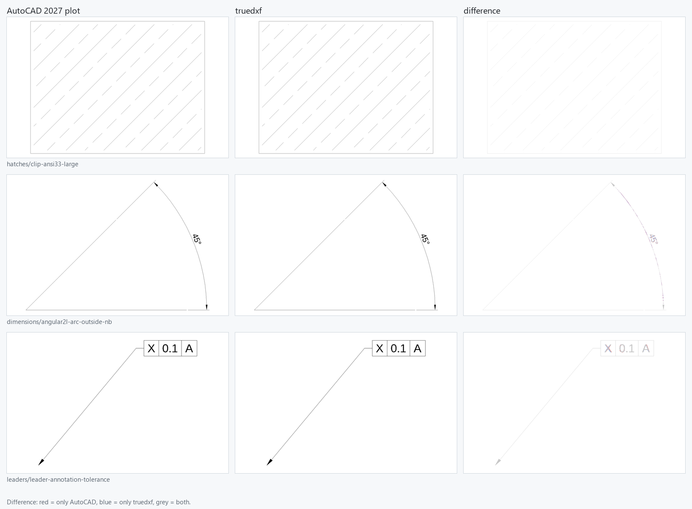

# truedxf

truedxf is a TypeScript DXF library that tries to be fast and to draw drawings exactly the way
AutoCAD plots them. Try the viewer at **<https://truedxf.pages.dev>**: files are opened in your
browser and never uploaded.



- **AutoCAD is the reference.** Over 3 500 generated test drawings are plotted by AutoCAD 2027
  and compared with truedxf's output pixel by pixel. When AutoCAD and the DXF reference disagree,
  AutoCAD wins, and what we learn is written down in [research/notes](research/notes/README.md).
- **Lossless.** The parser keeps every group code, including ones it does not understand. Typed
  entities, tables and objects are views over the raw tags, so nothing is lost on the way.
- **Browser and Node.** Everything below the renderer has no DOM or Node dependencies. The viewer
  parses and builds display lists in a worker and draws them with three.js (WebGL).

## Scoreboard

30 feature suites, 3 583 generated cases with AutoCAD references (2026-10-01). **Good** = F1 score
of at least 0.99 when ink pixels within 1 px of same-coloured ink count as matching; **exact** =
every pixel identical. Measured with the CPU scorer, which draws the same pixels as the browser
renderer in plot mode.

**3 279 good (92 %), 924 exact (26 %).**

| Suite | Cases | Good | Exact | | Suite | Cases | Good | Exact |
|---|---:|---:|---:|---|---|---:|---:|---:|
| calibration | 38 | 38 | 5 | | linetypes | 230 | 216 | 65 |
| lines-curves | 119 | 118 | 78 | | hatches | 279 | 247 | 140 |
| ocs | 91 | 80 | 34 | | text | 294 | 278 | 15 |
| polylines | 99 | 98 | 51 | | text-lato | 23 | 21 | 0 |
| points | 155 | 153 | 115 | | mtext | 250 | 209 | 1 |
| ellipses | 51 | 51 | 22 | | attribs | 65 | 64 | 3 |
| splines | 59 | 56 | 0 | | acad-default-fonts | 113 | 91 | 55 |
| solids | 43 | 43 | 38 | | dimensions | 366 | 362 | 1 |
| colors | 44 | 44 | 10 | | leaders | 128 | 111 | 26 |
| lineweights | 64 | 64 | 7 | | layouts | 169 | 155 | 7 |
| blocks | 88 | 82 | 42 | | xclip | 44 | 36 | 0 |
| transparency | 23 | 21 | 2 | | images | 174 | 156 | 137 |
| draworder | 34 | 34 | 26 | | mline | 54 | 40 | 16 |
| misc | 45 | 40 | 20 | | extents | 18 | 9 | 0 |
| mixed | 37 | 32 | 0 | | fileformat | 386 | 330 | 8 |

Most of the remaining gap is TrueType text rasterization (few text cases are pixel-exact). The
open work is listed in [docs/TODO.md](docs/TODO.md), and the method in [docs/PLAN.md](docs/PLAN.md).

## Packages

| Package | What |
|---|---|
| [`@truedxf/core`](packages/core) | Tokenizer for ASCII and binary DXF, encodings, lossless tag store |
| [`@truedxf/model`](packages/model) | Typed document: header, tables, blocks, entities, objects, property resolution |
| [`@truedxf/geometry`](packages/geometry) | OCS, arcs, ellipses, NURBS, flattening, stroking, dashing, hatching, clipping |
| [`@truedxf/fonts`](packages/fonts) | SHX fonts (shape, unifont, bigfont), TrueType, AutoCAD's font resolution |
| [`@truedxf/text`](packages/text) | TEXT and MTEXT parsing and layout |
| [`@truedxf/render`](packages/render) | Layouts, viewports, blocks and properties to a renderer-agnostic display list; AutoCAD raster rules |
| [`@truedxf/pdf`](packages/pdf) | PDF underlay content, rendered by PDF.js |
| [`@truedxf/three`](packages/three) | three.js renderer for the display list |
| [`@truedxf/viewer`](packages/viewer) | Embeddable viewer: worker pipeline, pan / zoom, layouts, layers, picking, measuring |
| [`@truedxf/testkit`](packages/testkit) | Scoring against AutoCAD: CPU rasterizer, headless Chromium harness, metrics (not published) |

[`apps/playground`](apps/playground) is the viewer app behind the website. [`tools/gen`](tools/gen)
generates the test drawings (Python, ezdxf), [`tools/acad`](tools/acad) plots them with AutoCAD,
[`tools/corpus`](tools/corpus) runs the parser over a corpus of real-world files.

## Usage

The packages are not on npm yet. Once they are:

```ts
import { DxfViewer } from "@truedxf/viewer";

const viewer = new DxfViewer(document.getElementById("view")!, { background: "dark" });
await viewer.load(file); // File, Blob, ArrayBuffer, Uint8Array or URL
viewer.on("select", async ({ handle }) => console.log(await viewer.inspect(handle)));
```

Without a viewer, `loadDxf` from `@truedxf/model` gives you the document and
`renderPlot` from `@truedxf/render` a display list or plot; see the package READMEs.

## Development

Needs Node 22.18+ and pnpm.

```bash
pnpm install
pnpm typecheck && pnpm lint && pnpm test
pnpm playground        # the viewer app on http://localhost:5173
```

The test drawings, AutoCAD references and the real-world corpus live in `samples/`, which is not
in the repository: real-world files are not ours to redistribute, and the references need a local
AutoCAD install. `tools/gen` regenerates the drawings; tests that need samples skip without them.
Contributor conventions are in [AGENTS.md](AGENTS.md).

Found a drawing that looks wrong? [Open an issue](https://github.com/tth05/truedxf/issues/new?template=rendering.yml)
with screenshots and, if you may share it, the file.

## License

MIT. truedxf ships no Autodesk files. The viewer site bundles the Liberation fonts (SIL OFL 1.1).
AutoCAD is a registered trademark of Autodesk, Inc.; truedxf is not affiliated with or endorsed
by Autodesk.
